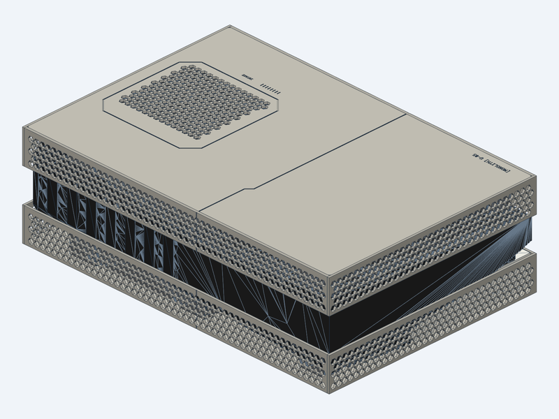
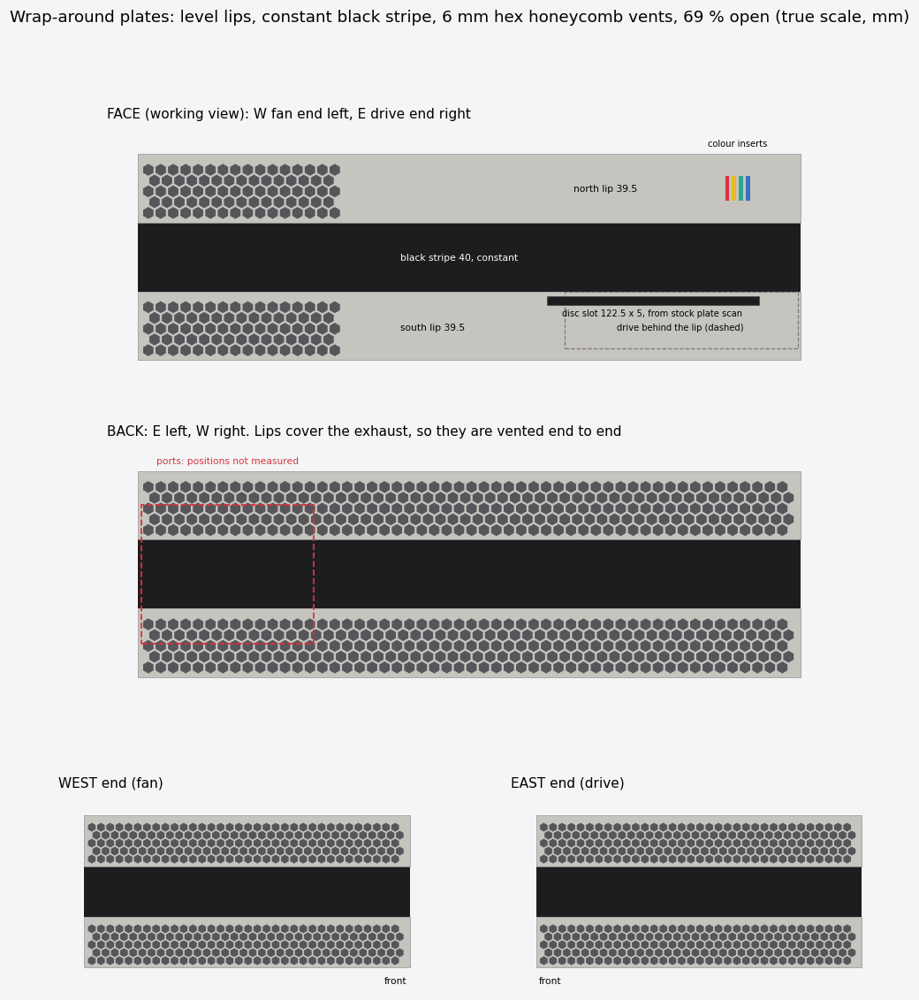
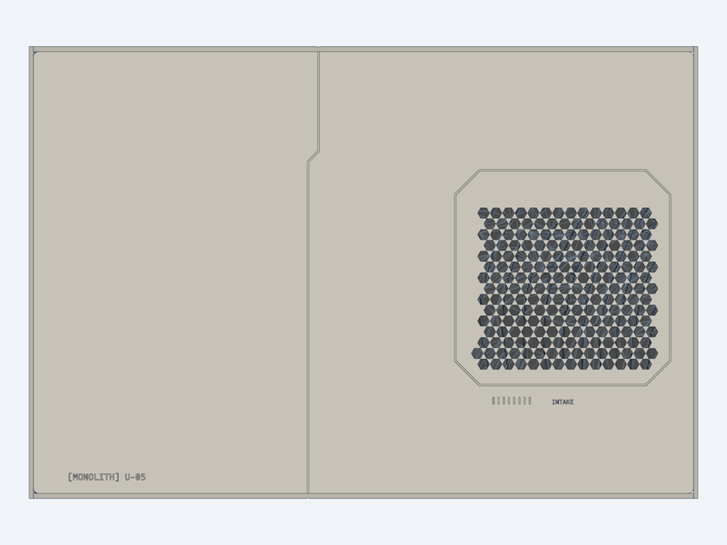
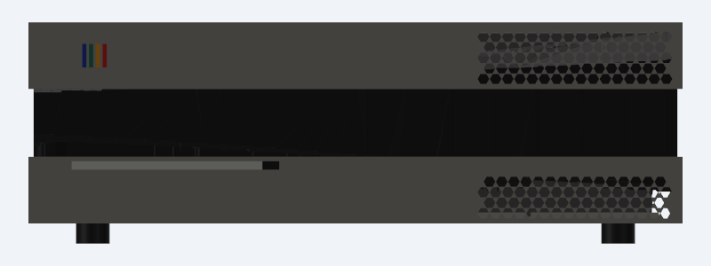

# 3DPrinting_CADs_visual-ps5-slab
Flat, PS1-grey replacement side plates that turn an original PS5 Disc Edition into a level, horizontal "slab", like a classic console under the TV.

> **Status: pre-alpha draft.** Not printed, and the fit is not tested. Some parts are still placeholders, listed under [What's missing](#whats-missing).



**Interactive 3D:** open [`docs/model/monolith_draft.stl`](docs/model/monolith_draft.stl) on GitHub to rotate and zoom the draft in the browser. It's one grey mesh of the plates, lip strips, clip strips, feet and the approximate console body.

### Technical mockup
True-scale views in mm. Seen from the front, the drive end is on the left.



| Top | Face |
|---|---|
|  |  |

## Design
- **Horizontal only, disc side down.** The console stands level on four TPU feet.
- **Wrap-around plates.** Two flat plates (north and south) wrap the console with **level lips** on the face, back and both ends. A **constant ~48 mm black stripe** of the console body stays visible all round, which hides the stock curves.
- **Separate lip strips.** The lips are printed as their own strips and welded to the plate edge, so the plate tiles stay 255 mm deep and fit a 256 mm print bed.
- **Disc drive behind the lip.** The drive sits behind the level south lip, like on the stock faceplate. The disc slot's size and position are taken from a scan of the stock plate: about 122.5 × 5 mm.
- **Honeycomb vents everywhere.** 6 mm hexagonal holes with 1.2 mm webs, ~69 % open: the fan grilles on both plates, the face lips at the fan end, the back lips along their full length (they cover the exhaust), and both end walls.
- **Four-colour inserts** on the face, visible from where you sit. No Sony logos or trademarks.
- **Engraved top, single grey.** The tile seam is drawn as a faceted panel line, so the joint hides in a deliberate groove. The fan grille sits inside a chamfered panel outline, and small mono markings read `[MONOLITH] U-05` and `INTAKE`.
- **Slide-in, replaceable clip strips** hold the plates onto the console's stock clip points.
- **Materials:** ASA or ABS for the plates, lips and clips, TPU for the feet. No PLA, because of the heat.

## Look at the model
The model is parametric Python (build123d) built with [cadgen](https://github.com/earthtojake/text-to-cad):

```bash
cadgen +0.8.4 run cad/wrap.py     # current draft; prints a viewer link
```

To refresh the interactive STL after a change: `cadgen +0.8.4 export <id> docs/model/monolith_draft.stl`, where `<id>` is the one the run prints. `docs/mockups/wrap_mockup.py` redraws the 2D views. `cad/slab.py` is the earlier concept, kept for its helpers.

## What's missing
- **Clip strips:** slide-in channels not designed yet. The old glued shelves stand in for them.
- **Seam joint:** the seam's path is set (the faceted panel line), but its stepped, self-aligning cross-section is not designed yet. The face and back lip strips also split there.
- **Port cut-outs** in the back lips: waiting on measurements.
- **Disc guide:** the short tunnel behind the slot and the stiffener above it.
- **Fit:** the console body is an approximate proxy, good to about ±1–2 mm. Before printing a full plate, print a test coupon and a narrow partial test strip, then check level with a spirit level (`TODO.md`).

## Repository
| Path | What |
|---|---|
| `cad/` | CAD models (`wrap.py` current, `slab.py` earlier), console proxies, renders |
| `analysis/` | Scan analysis: heightmaps, clip detection, sections, shelf generator |
| `deliverables/` | Fit tests to print first (`fit_tests/`, Bambu Studio–ready .3mf) and the hook coupons |
| `archive/` | Declined designs, kept for reference |
| `CHANGELOG.md` | Progress log |
| `docs/mockups/` | 2D design mockups |
| `docs/model/` | Exported draft STL (interactive on GitHub) |
| `sources/` | Third-party scans and reference images (their own licences) |
| `TODO.md` | Measuring jobs and print steps |
| `CLAUDE.md`, `HANDOFF.md` | Design decisions and working notes |

## Credits
Designed with [Claude Code](https://claude.com/claude-code). Clip geometry and plate surfaces are derived from "PS5 (Original - not slim) Side Panels" by Rhys34512 (Printables #973426), licensed CC BY-NC 4.0. The design ideas (level lips, wrap-around vents, slide-in clips, stepped seam) were inspired by Devyn Johnston's (devynPC) PS5 plate videos. None of his files or patterns are used.

## License
Copyright (c) 2026 beliykelevra. Licensed under [CC BY-NC 4.0](https://creativecommons.org/licenses/by-nc/4.0/): free to share and adapt with attribution, not for commercial use. Full text in `LICENSE`.

Third-party files in `sources/` are not covered by this grant and remain under their own authors' terms.

### Third-party material in this repo
| Files | Source | Licence |
|---|---|---|
| `sources/rhys34512-printables-973426/` | "PS5 (Original - not slim) Side Panels" by Rhys34512, Printables #973426 | CC BY-NC 4.0 |
| `sources/reference-images/teardown_ifixit.jpg`, `xray_creative_electron_ifixit.jpg` | iFixit PS5 teardown; X-ray by Creative Electron, published by iFixit | CC BY-NC-SA 3.0 (iFixit) |
| `sources/reference-images/xray_fan_fit_overlay.png` | Our overlay on the iFixit X-ray above | CC BY-NC-SA 3.0, as a derivative |
| `sources/reference-images/xray_ports_overlay.png` | Our I/O-position overlay on the iFixit X-ray above (`tools/xray_ports_overlay.py`) | CC BY-NC-SA 3.0, as a derivative |

Other references used during design (style renders, a devynPC photo, two visual PS5 models, a MakerWorld copy of the scan) are **not included**, because their licences don't allow redistribution or are unknown.
